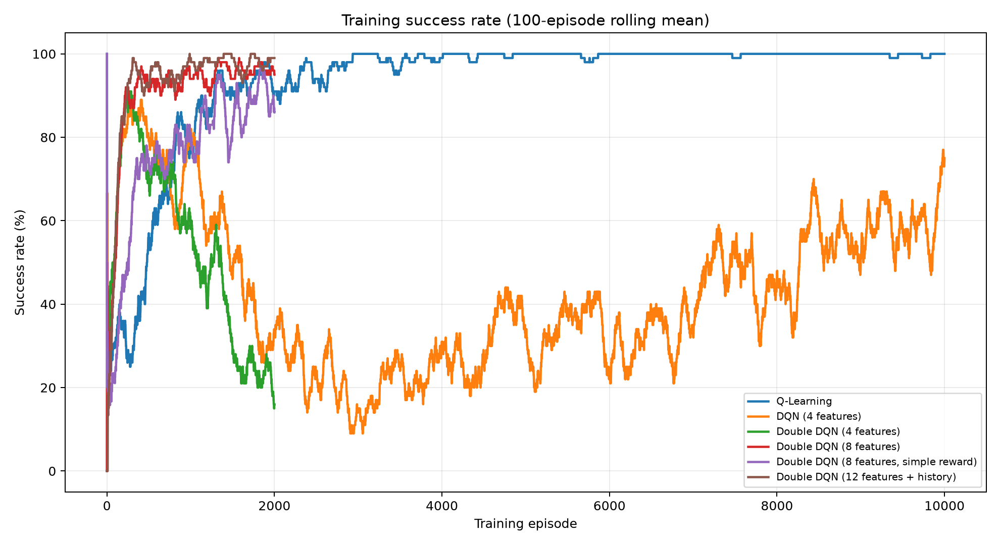
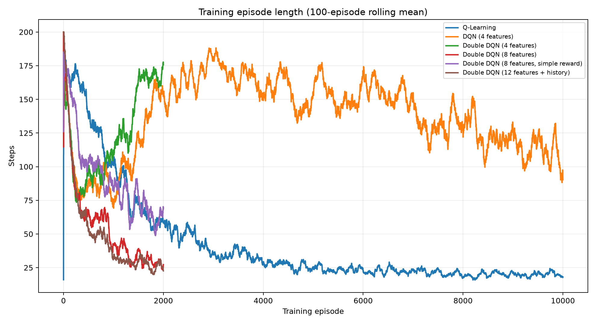
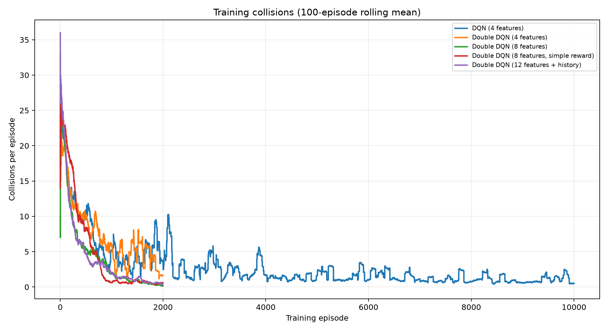
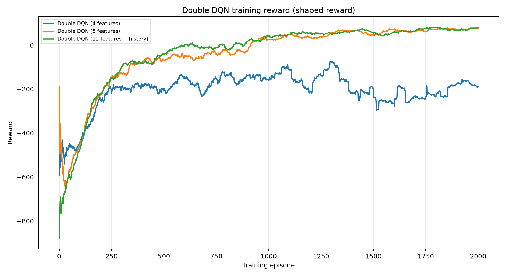
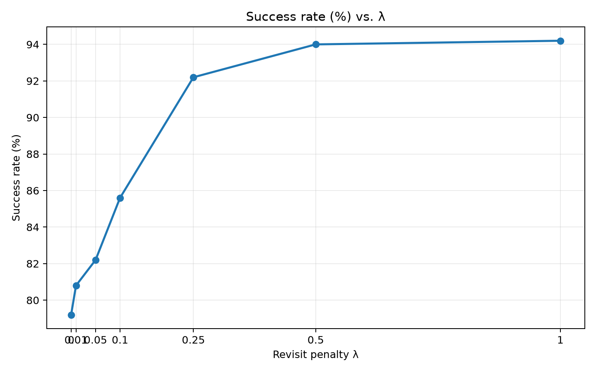
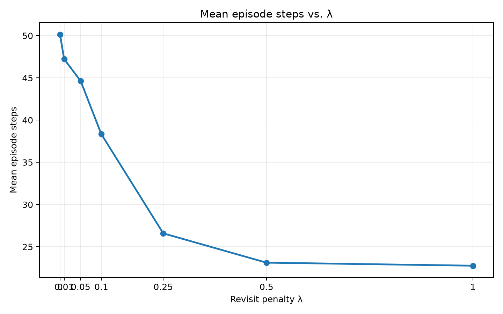
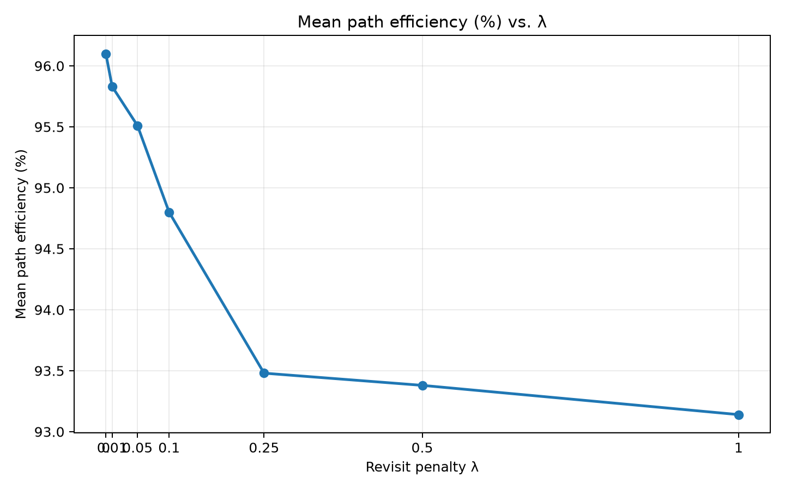
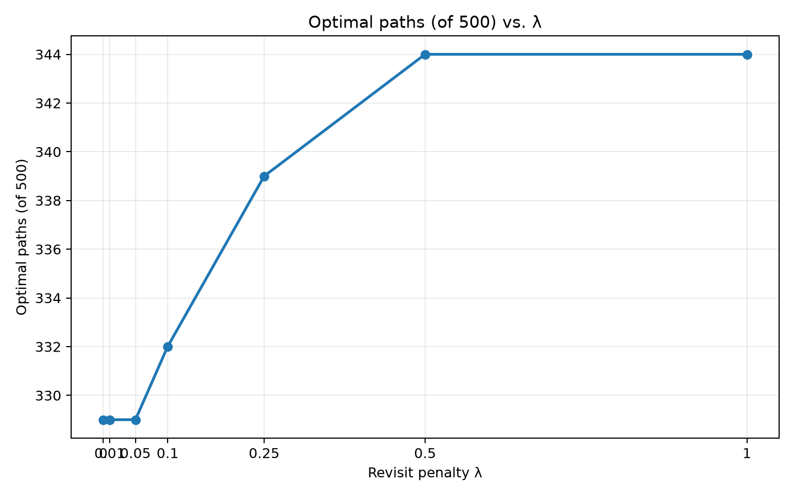

# Robot Navigation with Reinforcement Learning

**Comparing Q-Learning, DQN, and Double DQN in a 2D grid world**

This project explores how reinforcement learning agents learn to navigate a grid containing obstacles. Starting with tabular Q-Learning, the experiments progress to Deep Q-Networks (DQN), Double DQN, obstacle-aware observations, and short-term position memory. A final **soft revisit penalty** improves navigation reliability by discouraging repeated visits to the same cells during action selection.

The main finding is that a learned policy can find very efficient routes when it succeeds, but can become trapped in cycles. Combining the trained Double DQN with a lightweight revisit penalty increased greedy evaluation success from **79.2% to 94.2%** on 500 evaluation scenarios.

## Highlights

| Metric | Double DQN + history (greedy) | Double DQN + history + revisit penalty (λ = 1.0) |
|---|---:|---:|
| Evaluation episodes | 500 | 500 |
| Success rate | 79.2% | **94.2%** |
| Mean episode steps | 50.15 | **22.76** |
| Mean collisions | 0.00 | 0.00 |
| Mean path efficiency, successful episodes | **96.10%** | 93.14% |
| Optimal-length paths | 329 / 500 | **344 / 500** |

**Important:** The 94.2% policy is a *hybrid*: a trained Double DQN plus an inference-time, hand-designed revisit penalty and invalid-action filtering. It is not the performance of the neural network alone. These 500 scenarios were used to compare penalty strengths, so the result is best treated as a validation-set result rather than an untouched final test.

## Environment

The custom environment follows the Gymnasium interface and represents a robot moving on a **15 × 15 grid** with fixed obstacles. Each episode samples a reachable start and goal position and ends when the robot reaches the goal or after **200 steps**.

**Actions (4 discrete):**

| Action | Movement |
|---|---|
| `0` | Right `(0, +1)` |
| `1` | Left `(0, -1)` |
| `2` | Up `(-1, 0)` |
| `3` | Down `(+1, 0)` |

The environment supports Pygame rendering. Invalid moves do not change the robot's position.

### Observation representations

The project tests increasingly informative observations:

| Version | Features | Contents |
|---|---:|---|
| Basic | 4 | Robot row/column and goal row/column |
| Obstacle-aware | 8 | Basic features plus four neighboring obstacle indicators |
| History-aware | **12** | Obstacle-aware features plus four recent-visit counts |

The final observation is:

```text
[
  robot_row, robot_col, goal_row, goal_col,
  blocked_right, blocked_left, blocked_up, blocked_down,
  visits_right, visits_left, visits_up, visits_down
]
```

The visit counts describe how often the corresponding neighboring cell appears in a rolling history of the **last five robot positions**. Coordinates are scaled by 14 and visit counts by 5 before entering the neural network.

### Reward function

The main Double DQN experiments use a distance-shaped reward:

| Event | Reward |
|---|---:|
| Valid move closer to the goal | `0` (`-1` step cost + `1` shaping) |
| Valid move farther from the goal | `-2` (`-1` step cost − `1` shaping) |
| Collision / invalid move | `-20` |
| Reach the goal | `+100` |

Distance is measured using Manhattan distance. The terminal goal reward replaces the normal movement reward on the goal-reaching step. A separate experiment tested a simpler reward (`-1` per step, `-5` collision, `+100` goal); its training log is retained for comparison.

## Algorithms

- **Tabular Q-Learning:** a discrete-state baseline.
- **DQN:** approximates action values with a neural network and uses experience replay and a target network.
- **Double DQN:** selects the next action using the online network and evaluates it using the target network, reducing the overestimation associated with the standard DQN target.
- **Double DQN + history:** augments the input with recent visits to neighboring cells.
- **Double DQN + soft revisit penalty:** changes action selection at evaluation time, without retraining.

The neural-network agent uses an MLP with **two hidden layers of 128 ReLU units** and four action outputs. The history-aware version has 12 input features.

### Main training configuration

| Hyperparameter | Value |
|---|---|
| Optimizer | Adam |
| Learning rate | `0.0005` |
| Discount factor (γ) | `0.99` |
| Replay capacity | `100,000` |
| Batch size | `64` |
| Target-network synchronization | Every `1,000` environment steps |
| Loss | Huber loss |
| Gradient clipping | Max norm `10` |
| Exploration | ε-greedy; linear schedule from `1.0` toward `0.05` over `100,000` steps |
| History-aware Double DQN training | `2,000` episodes |

The history-aware training run ended at approximately 93,956 environment steps, with ε ≈ 0.1074; it had not yet reached the schedule's minimum.

## Why recent-position memory?

Initial greedy policies often oscillated between neighboring cells:

```text
A → B → A → B → A → B → ...
```

Without history, returning to the same robot/goal configuration produces the same observation, making these loops difficult to escape. Recent-visit features expose some of this repetition to the network.

On the original **100 evaluation seeds (42–141)**, the history-aware Double DQN achieved **78%** greedy success. Of the 22 failures, a diagnostic classified **12 as two-cell cycles** and **10 as longer repeating cycles**. No failure fell outside these detected end-of-episode cycle patterns.

For the 78 successful episodes, breadth-first search (BFS) provided shortest-path references:

- Mean path efficiency: **96.25%**
- Mean extra steps above BFS: **0.59**
- Optimal-length routes: **64 / 78** successful episodes

This suggests the principal remaining problem was **reliability**, rather than route length on successful episodes.

## Soft revisit penalty

At evaluation time, the action-selection rule becomes:

\[
 a^* = \arg\max_{a \in A_{\mathrm{valid}}(s)}
 \left(Q_\theta(s,a) - \lambda N(s'_a)\right)
\]

Here, `N(s'_a)` counts recent visits to the position reached by action `a`, and `λ` determines how strongly revisits are discouraged. Invalid actions are excluded. The neural-network weights are unchanged.

### Penalty sweep: 500 evaluation episodes

| λ | Success rate | Mean episode steps | Mean successful-path efficiency | Optimal paths |
|---:|---:|---:|---:|---:|
| 0 | 79.2% | 50.15 | **96.10%** | 329 / 500 |
| 0.01 | 80.8% | 47.22 | 95.83% | 329 / 500 |
| 0.05 | 82.2% | 44.63 | 95.51% | 329 / 500 |
| 0.10 | 85.6% | 38.34 | 94.80% | 332 / 500 |
| 0.25 | 92.2% | 26.59 | 93.48% | 339 / 500 |
| 0.50 | 94.0% | 23.12 | 93.38% | 344 / 500 |
| **1.00** | **94.2%** | **22.76** | 93.14% | **344 / 500** |

Increasing the penalty improved success and reduced the number of steps per episode in this sweep, while slightly lowering path efficiency *conditional on success*. The improvement from λ = 0 to λ = 1.0 is **15 percentage points** (75 more successes in 500 episodes).

## Visualizations

Generate the plots using:

```bash
python -m src.visualize
```

The script reads training logs from `results/logs/` and writes figures to `results/plots/`.

### Training









**Note:** Training success and episode length include ε-greedy exploration and should not be confused with greedy evaluation. Raw rewards from different reward-function experiments are not directly comparable.

### Revisit-penalty ablation









The penalty-sweep values in the current visualization script are recorded from the 500-episode experiment.

## Installation

Use Python **3.10 or newer** in a virtual environment.

**Windows PowerShell:**

```powershell
python -m venv .venv
.\.venv\Scripts\Activate.ps1
pip install -r requirements.txt
```

**macOS / Linux:**

```bash
python3 -m venv .venv
source .venv/bin/activate
pip install -r requirements.txt
```

> PyTorch installation may vary depending on your operating system and whether you want CUDA acceleration. See the [official PyTorch installation instructions](https://pytorch.org/get-started/locally/) for platform-specific builds.

## Usage

Run commands from the **project root**.

```bash
# Train the Double DQN (check src/train_dqn.py for active configuration)
python -m src.train_dqn

# Evaluate saved history-aware checkpoints
python -m src.evaluate_history

# Analyze failed navigation trajectories
python -m src.analyze_history_failures

# Compare successful paths against BFS shortest paths
python -m src.evaluate_path_efficiency

# Sweep soft revisit penalties
python -m src.evaluate_soft_penalty

# Generate training and evaluation charts
python -m src.visualize
```

The training script saves checkpoints under `results/models/` and logs under `results/logs/`. **Check the output filenames and model input dimension before training or loading a different experiment**, since checkpoints for 4-, 8-, and 12-feature networks are not interchangeable.

## Project layout

```text
RobotNavigation/
├── src/
│   ├── environment.py                  # Gymnasium grid environment
│   ├── dqn_agent.py                    # DQN / Double DQN agent and replay buffer
│   ├── train_dqn.py                    # Deep RL training
│   ├── evaluate_history.py            # Greedy checkpoint evaluation
│   ├── analyze_history_failures.py     # Detect repeated navigation cycles
│   ├── evaluate_path_efficiency.py     # Compare successful routes with BFS
│   ├── evaluate_soft_penalty.py        # Inference-time revisit penalty sweep
│   └── visualize.py                    # Training and evaluation figures
├── results/
│   ├── logs/                           # CSV experiment logs
│   ├── models/                         # Saved PyTorch checkpoints
│   └── plots/                          # Generated figures
├── requirements.txt
└── README.md
```

Other baseline scripts, tests, and visualization utilities may also be present in your local project.

## Limitations and future work

- The grid and obstacle layout are fixed; generalization to new obstacle maps remains untested.
- The final policy combines learned Q-values with a hand-designed action-selection penalty.
- The five-position visit-count representation does not preserve the complete ordered trajectory.
- A separate untouched test set and repeated training seeds would strengthen the reported comparisons.
- Future extensions could include randomized maps, dynamic obstacles, longer-range sensing, and learned alternatives to the revisit penalty.

## Takeaway

The experiments illustrate an important reinforcement-learning lesson: **a policy can learn nearly optimal paths yet still fail because of repeated local decisions**. Adding obstacle information and recent-position features improved the learned policy; a simple soft revisit penalty further improved reliability, reaching **94.2% success** on the 500-scenario evaluation sweep.
